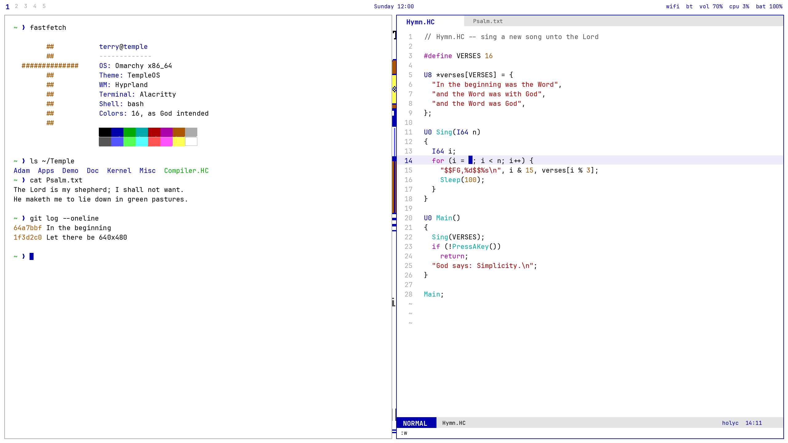

# TempleOS for Omarchy

> "An idiot admires complexity, a genius admires simplicity." — Terry A. Davis (1969–2018)

A light [Omarchy](https://omarchy.org) theme built from the 16-color EGA palette of
[TempleOS](https://templeos.org): blue ink on a white page, double-line blue window
borders, and pixel-art wallpapers drawn at 640×360 and scaled up 6× with nearest-neighbor.



## Install

```sh
omarchy theme install https://github.com/noisyloop/omachy-TempleOS
```

## Palette

| Role       | Color     | EGA name    |
|------------|-----------|-------------|
| Background | `#FFFFFF` | White       |
| Foreground | `#0000AA` | Blue        |
| Accent     | `#0000AA` | Blue        |
| Selection  | `#55FFFF` | Light cyan  |
| Red        | `#AA0000` | Red         |
| Green      | `#00AA00` | Green       |
| Yellow     | `#AA5500` | Brown       |
| Cyan       | `#00AAAA` | Cyan        |
| Magenta    | `#AA00AA` | Purple      |
| Muted      | `#AAAAAA` | Light gray  |

The bright row is the other half of the EGA palette (`#5555FF`, `#55FF55`, `#55FFFF`,
`#FF5555`, `#FF55FF`, `#FFFF55`). On a white page, dim "yellow" is EGA brown, just as
it is on the real hardware, so warnings stay readable.

## What's included

- `colors.toml`: the palette. Omarchy generates the terminal, Hyprland borders, Neovim,
  Waybar/shell, Walker, Mako, btop, and other configs from it.
- `btop.theme`: a hand-tuned btop palette.
- `backgrounds/`: three wallpapers (the Temple, a HolyC listing, and a blue title screen).
- `unlock.png`: the pixel-font TempleOS logo for the disk-unlock (Plymouth) screen.
- `icons.theme`, `chromium.theme`: Yaru-blue icons and a white browser frame.

## Credits

The bitmap glyphs in the wallpapers come from [font8x8](https://github.com/dhepper/font8x8)
by Daniel Hepper (public domain). TempleOS was created by Terry A. Davis. This theme is
a tribute; it isn't affiliated with the TempleOS project.
